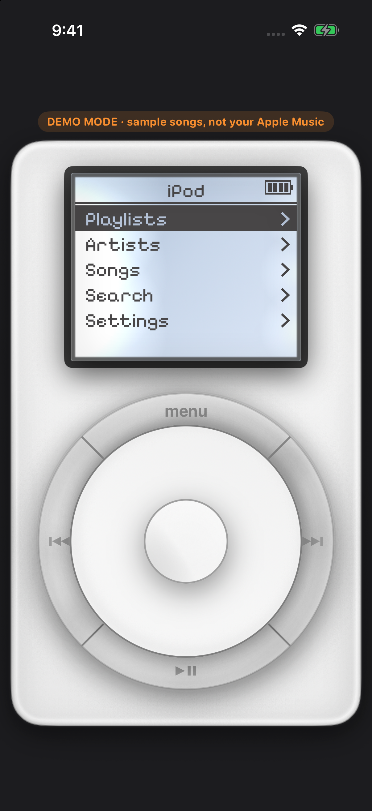

# iPodMusic

iPodMusic is an iOS SwiftUI app that draws a classic iPod — LCD, click wheel, and all — and plays music from Apple Music, Spotify, or YouTube Music. On the home screen the display name is **iPod**.



Portrait shows the iPod body, scaled to the phone. Rotate to landscape for Cover Flow. Turn on **Jukebox Style** in Settings and the cabinet fills the screen in either orientation.

## Features

**iPod**

- Click wheel with Menu, previous, next, and play/pause, a center select button, and a scroll ring. Scrolling moves the menu highlight, and speeds up as the wheel turns faster. On Now Playing, scrolling changes volume and the center button turns scrubbing on and off. Holding previous or next seeks. Holding Menu toggles the backlight.
- LCD menus for the library, Settings, and Now Playing (title, artist, album, progress). Album art can be turned off.
- Click sound and haptics, a backlight timer, and an idle timeout that opens Now Playing when **Auto Now Playing** is on.
- Themes: White, Black, and U2 Red.
- Shuffle (off or songs) and repeat (off, one, or all).

**Library menus**

- Apple Music (MusicKit): Playlists, Artists (albums and all songs), Songs, and catalog Search (songs, albums, artists, playlists). The Songs list has Shuffle Songs. Cover Flow and the jukebox load albums from the library.
- Spotify: Playlists, followed artists, saved albums, saved songs, and search. Playback uses the Spotify iOS SDK (App Remote) against the installed Spotify app, with the Web API as a fallback. Spotify Premium and the Spotify app are required. Playlist tracks are the ones you own or collaborate on.
- YouTube Music: your playlists (plus Liked Music), subscribed channels, liked videos in the Music category, and music-category search. There is no album list; the Albums screen says the YouTube API does not provide one. Playback is the official YouTube IFrame player in a web view. YouTube requires that player to stay on screen and at least 200×200 points, so it takes over the iPod screen during Now Playing and pauses when you leave. **Open in YT Music** hands a playlist to the YouTube Music app.

**Cover Flow and jukebox**

- Landscape Cover Flow shows album artwork with a reflection. Tap a cover to flip it and play songs from that album.
- Jukebox Style is a floor-model cabinet (arched crown, title strips, number keypad, record window). Pick a strip or type its number, then flip the record to play. An **iPod** button returns to the device view.

**Setup**

- Settings ▸ Source switches between Apple Music, Spotify, and YouTube Music.
- Settings ▸ Set Up Spotify and Set Up YouTube open a guided sheet: paste a client ID, sign in (OAuth with PKCE), run a playlist test, disconnect, or reset. IDs saved on the phone override `Config/Sources.xcconfig`, so setup does not need a rebuild. Tokens stay in the Keychain. There is no client secret in the app.
- **Demo Mode** plays a fixed set of labelled sample songs with no audio. The iOS Simulator always forces Demo Mode, because it has no Apple Music library.

## Requirements

From the Xcode project (`LastUpgradeCheck` and the scheme’s `LastUpgradeVersion` are **2720**, project object version 77):

| | |
| --- | --- |
| Xcode | 27.2 or newer (the version that last upgraded this project) |
| iOS | 17.0 deployment target |
| Swift | 5 language mode |
| Devices | The target’s `TARGETED_DEVICE_FAMILY` is `1,2` (iPhone and iPad). Supported orientations are portrait and both landscapes; iPad also allows upside down. |
| Dependency | [Spotify iOS SDK](https://github.com/spotify/ios-sdk) 5.0.1, via Swift Package Manager (`Package.resolved` pins 5.0.1). YouTube uses `WebKit`; it has no extra package. |
| Signing | Automatic, bundle ID `com.sergebl.iPodMusic`, development team `X647WK46TN` |

Version is 1.0.0 (build 1). The app asks for Apple Music access, declares the `ipodmusic` URL scheme (Spotify’s redirect is `ipodmusic://spotify-callback`), queries the `spotify`, `youtube`, and `youtubemusic` schemes, and enables background audio. The LCD font is [Pixelify Sans](iPodMusic/Fonts/OFL.txt) (SIL Open Font License).

## Build and run

1. Open `iPodMusic.xcodeproj` and select the **iPodMusic** scheme.
2. If signing fails, set your own team under Signing & Capabilities. The Spotify and YouTube setup guides copy the bundle ID `com.sergebl.iPodMusic` and team ID `X647WK46TN` into the developer consoles, so a different bundle ID or team has to match what you register there.
3. Run on an iPhone or iPad simulator, or on a device with iOS 17 or later.
   - Simulator: Demo Mode only (sample songs, no audio, no Apple Music library).
   - Device, Apple Music: allow library access when prompted.
4. Spotify or YouTube: Settings ▸ Set Up Spotify / Set Up YouTube, and follow the sheet. Optional build-time IDs go in `Config/Sources.xcconfig` (`SPOTIFY_CLIENT_ID`, `GOOGLE_CLIENT_ID`), which is applied to Debug and Release and copied into `Info.plist`. A client ID saved in the app wins over those values.

From the command line, after packages have resolved:

```sh
xcodebuild -project iPodMusic.xcodeproj -scheme iPodMusic \
  -destination 'platform=iOS Simulator,name=iPhone 16' build
```

There is no test target.

## Project structure

```
iPodMusic.xcodeproj/     Shared project and iPodMusic scheme
project.yml              XcodeGen spec (see below)
Config/Sources.xcconfig  Optional Spotify and Google client IDs
CoverFlowLayout.swift    UIKit collection-view layout; not compiled (see below)
shots/                   Reference screenshots
iPodMusic/
  iPodMusicApp.swift     App entry, environments, URL and scene-phase handling
  ContentView.swift      iPod body, Cover Flow, jukebox switch, YouTube player slot
  LCDView.swift          Menu list and Now Playing
  ClickWheelView.swift   Click wheel
  Navigator.swift        Menu stack, wheel gestures, settings actions
  Library.swift          Apple Music (MusicKit) and demo menus
  PlayerModel.swift      MusicKit player, demo clock, remote playback
  Models.swift           Screens, rows, demo songs
  Settings.swift         Themes and UserDefaults settings
  Sources.swift          Source hub, client IDs, OAuth PKCE, Keychain
  SpotifyService.swift   Spotify Web API and App Remote
  YouTubeService.swift   YouTube Data API and IFrame player
  SetupView.swift        Spotify and YouTube setup sheet
  JukeboxCabinetView.swift
  Feedback.swift         Click sound and haptics
  Info.plist
  Assets.xcassets
  Fonts/                 Pixelify Sans and its OFL license
  Sounds/click.wav
```

## `project.yml` and XcodeGen

`project.yml` is an [XcodeGen](https://github.com/yonaskolb/XcodeGen) spec. It matches the checked-in project on the things it declares: iOS 17.0, Swift 5, marketing version 1.0.0, bundle ID `com.sergebl.iPodMusic`, team `X647WK46TN`, automatic signing, `iPodMusic/Info.plist`, sources under `iPodMusic/`, `Config/Sources.xcconfig` for Debug and Release, the SpotifyiOS package from 5.0.1, and the `iPodMusic` scheme.

It is not a perfect snapshot of `iPodMusic.xcodeproj`:

- **Device family.** `project.yml` and the project-level build setting are iPhone only (`TARGETED_DEVICE_FAMILY = 1`). The **target** overrides that to `1,2` (iPhone and iPad). Xcode uses the target setting.
- **`CoverFlowLayout.swift`.** The file sits at the repo root and is listed in the Xcode project navigator, but it is not in Compile Sources. Cover Flow on screen is the SwiftUI layout in `ContentView.swift`. `project.yml` only includes the `iPodMusic/` folder, so it does not mention this file.

Open `iPodMusic.xcodeproj` to build. Regenerating with XcodeGen would rebuild the project from `project.yml` and drop those two differences (iPhone-only target, no `CoverFlowLayout.swift` reference).

## Notes

- `Library.swift` can build Genres and Recently Added rows, and Spotify treats Recently Added like Albums. Nothing in the current menus navigates to those screens. Apple Music albums are reached from an artist, from Search, and from Cover Flow / the jukebox. Spotify and YouTube put Albums on the main menu; YouTube’s album screen explains that the API has none.
- Launch arguments such as `-startScreen nowPlaying` (also `songs`, `settings`, `setupSpotify`, `setupYouTube`, `source`) are read from UserDefaults and used to open a screen directly, including for the images in `shots/`.
- Client IDs are public OAuth identifiers. Keep secrets out of the repo; `.gitignore` already excludes env files, tokens, and credential JSON.
